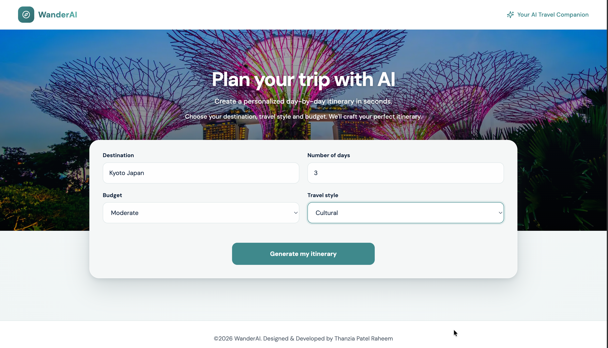
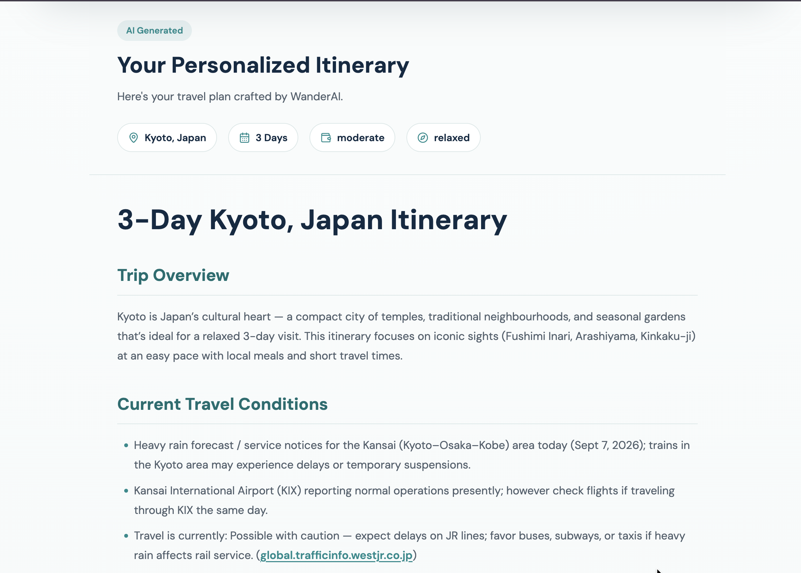
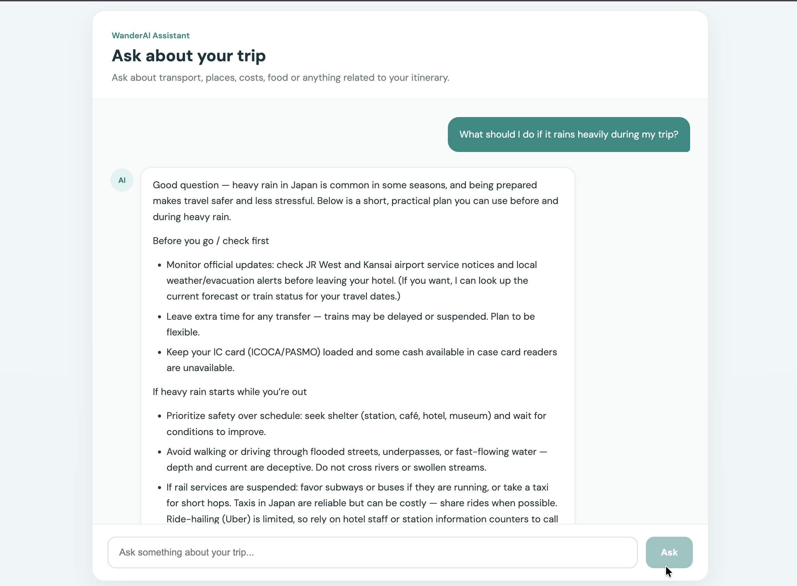

# 🌍 WanderAI – AI-Powered Travel Itinerary Planner

WanderAI is a full-stack AI-powered travel planning application that generates personalized travel itineraries based on a user's destination, trip duration, budget, and travel preferences.

The application uses the **OpenAI API** to generate travel plans with real-time streaming and provides a **Retrieval-Augmented Generation (RAG) travel assistant** that allows users to ask contextual follow-up questions about their generated itineraries.

Built with React, Node.js, Express, OpenAI, and Supabase, WanderAI is containerized using Docker and deployed on AWS EC2 with automated CI/CD pipelines using GitHub Actions.

### 🔗 Live Demo

**[Explore WanderAI](http://18.141.233.167)**

**[GitHub Repository](https://github.com/ThanziaPatelRaheem/WanderAI)**

---

## ✨ Features

### 🗺️ AI-Powered Itinerary Generation

- Generate personalized travel itineraries based on destination, duration, budget, and travel style.
- Receive structured, day-by-day travel recommendations.
- Get suggestions for attractions, activities, and travel experiences.
- Stream generated itinerary content in real time using the OpenAI API.

### 🤖 RAG-Powered Travel Assistant

- Ask follow-up questions about generated itineraries.
- Retrieve relevant itinerary information using semantic vector search.
- Generate contextual responses using retrieved itinerary content.
- Maintain multi-turn conversation context.
- Stream AI responses for an interactive chat experience.
- Handle unrelated queries to keep conversations focused on travel planning.

### 💻 Responsive User Interface

- Responsive React interface for mobile, tablet, and desktop.
- Interactive itinerary generation form.
- Form validation, loading indicators, and error handling.
- Formatted itinerary display.
- Dedicated **Ask WanderAI about your trip** button.
- Expandable AI travel assistant chat window.

### ☁️ Deployment and DevOps

- Containerized frontend and backend using Docker.
- Docker Compose for multi-container orchestration.
- Nginx for serving the React application and proxying API requests.
- Deployment on AWS EC2.
- GitHub Actions CI pipeline for automated testing and Docker builds.
- GitHub Actions CD pipeline for automated deployment after successful CI.
- AWS Systems Manager for remote deployment execution.
- GitHub OIDC authentication for secure AWS access without long-lived AWS credentials.

---

## 🛠️ Tech Stack

| Category         | Technologies                              |
| ---------------- | ----------------------------------------- |
| Frontend         | React, Vite, JavaScript, CSS              |
| Backend          | Node.js, Express.js, REST APIs            |
| AI               | OpenAI Responses API, OpenAI Embeddings   |
| RAG              | LangChain Text Splitters, Semantic Search |
| Vector Database  | Supabase, PostgreSQL with pgvector        |
| Containerization | Docker, Docker Compose                    |
| Web Server       | Nginx                                     |
| Cloud            | AWS EC2, AWS Systems Manager, AWS IAM     |
| CI/CD            | GitHub Actions, GitHub OIDC               |
| Testing          | Vitest, React Testing Library, Playwright |
| Version Control  | Git, GitHub                               |

---

## 🏗️ Application Architecture

WanderAI uses a React frontend and an Express backend, with separate workflows for itinerary generation and contextual AI chat.

### Itinerary Generation

```text
User
  |
  v
React Frontend
  |
  | HTTP Request
  v
Express Backend
  |
  v
OpenAI Responses API
  |
  | Streaming Response
  v
React Itinerary Display
  |
  v
Generated Itinerary
  |
  v
Text Chunking + OpenAI Embeddings
  |
  v
Supabase Vector Database
```

### RAG Travel Assistant

```text
User asks a question
        |
        v
React Chat Interface
        |
        v
Express Backend
        |
        v
Generate Query Embedding
        |
        v
Supabase Vector Similarity Search
        |
        v
Retrieve Relevant Itinerary Chunks
        |
        v
OpenAI Responses API
        |
        v
Contextual AI Response
        |
        v
Streaming Chat Interface
```

The RAG workflow helps the assistant answer questions using information from the user's generated itinerary rather than relying only on the model's general knowledge.

---

## 🧠 How RAG Works

WanderAI uses Retrieval-Augmented Generation to support contextual travel conversations.

1. **Generate itinerary:** The OpenAI API creates a personalized travel itinerary.

2. **Split content:** The generated itinerary is divided into smaller text chunks using LangChain's `RecursiveCharacterTextSplitter`.

3. **Generate embeddings:** Each chunk is converted into a vector embedding using OpenAI's `text-embedding-3-small` model.

4. **Store embeddings:** The embeddings are stored in Supabase using PostgreSQL with pgvector.

5. **Process user questions:** When a user asks a question, the backend generates an embedding for the question.

6. **Retrieve context:** Supabase performs vector similarity search to retrieve relevant itinerary chunks.

7. **Generate an answer:** The retrieved context and conversation history are passed to the OpenAI Responses API.

8. **Stream the response:** The answer is streamed to the frontend chat interface.

This architecture combines semantic retrieval, conversation context, and LLM-generated responses to create a more relevant travel assistant.

---

## 📁 Project Structure

```text
WanderAI/
│
├── client/
│   ├── src/
│   │   ├── components/
│   │   ├── pages/
│   │   └── assets/
│   ├── Dockerfile
│   └── package.json
│
├── server/
│   ├── controllers/
│   ├── routes/
│   ├── services/
│   ├── config/
│   ├── Dockerfile
│   └── package.json
│
├── .github/
│   └── workflows/
│       ├── ci.yml
│       └── deploy.yml
│
├── screenshots/
│   ├── itinerary-form.png
│   ├── generated-itinerary.png
│   ├── ask-wanderai-button.png
│   └── travel-assistant.png
│
├── compose.yaml
└── README.md
```

_This structure highlights the main project directories and deployment files._

---

## ⚙️ Getting Started

### Prerequisites

Make sure the following are installed:

- Node.js and npm
- Git
- Docker and Docker Compose (for containerized setup)

You will also need:

- An OpenAI API key
- A Supabase project with the required vector database configuration

### 1. Clone the repository

```bash
git clone https://github.com/ThanziaPatelRaheem/WanderAI.git

cd WanderAI
```

### 2. Install dependencies

Frontend:

```bash
cd client
npm install
```

Backend:

```bash
cd ../server
npm install
```

### 3. Configure environment variables

Create a `.env` file inside the `server` directory.

Example:

```env
PORT=8080
FRONTEND_URL=http://localhost:5173

OPENAI_API_KEY=your_openai_api_key
OPENAI_MODEL=gpt-5-mini

SUPABASE_URL=your_supabase_project_url
SUPABASE_KEY=your_supabase_key
```

Replace the placeholders with your own credentials.

**Security:** Never commit `.env` files or API keys to GitHub. All OpenAI and Supabase credentials must remain on the backend.

The Supabase project must also contain the vector storage table and similarity-search function expected by the backend.

### 4. Start the backend

From the `server` directory, run the development script defined in `server/package.json`.

### 5. Start the frontend

In a separate terminal:

```bash
cd client
npm run dev
```

Open the local URL displayed by Vite in your browser.

---

## 🐳 Docker Setup

WanderAI uses separate Docker containers for its frontend and backend.

- **Frontend:** React application built with Vite and served through Nginx.
- **Backend:** Express server handling itinerary generation, OpenAI integration, and RAG chat.
- **Docker Compose:** Manages both services and their networking.

To build and start the application:

```bash
docker compose up -d --build
```

To view running containers:

```bash
docker compose ps
```

To stop the containers:

```bash
docker compose down
```

The published frontend port is configured in `compose.yaml`.

---

## 🚀 CI/CD Pipeline

WanderAI uses GitHub Actions to automate testing and deployment.

### Continuous Integration (CI)

The CI workflow runs on pushes and pull requests to the `main` branch.

It performs:

- Backend tests
- Frontend tests
- End-to-end tests using Playwright
- Docker image build validation

### Continuous Deployment (CD)

After a successful CI run triggered by a push to `main`, the CD workflow automatically deploys the application to AWS EC2.

```text
Developer pushes code to GitHub
              |
              v
       GitHub Actions CI
              |
              v
     Automated Tests Pass
              |
              v
      Docker Build Checks
              |
              v
       GitHub Actions CD
              |
              v
     GitHub OIDC Authentication
              |
              v
       AWS Systems Manager
              |
              v
           AWS EC2
              |
              v
       Docker Compose Build
              |
              v
      Updated WanderAI App
```

### Secure AWS Deployment

The deployment pipeline uses:

- **GitHub OIDC** to obtain temporary AWS credentials.
- **AWS IAM** to restrict deployment permissions.
- **AWS Systems Manager Run Command** to execute deployment commands on EC2.
- **Docker Compose** to rebuild and restart the application services.

This avoids storing permanent AWS access keys in GitHub and removes the need to expose SSH access to GitHub-hosted runners.

---

## 🧪 Testing

WanderAI includes automated tests covering frontend and backend functionality, along with browser-based end-to-end testing.

| Testing Area | Tools                         |
| ------------ | ----------------------------- |
| Backend      | Vitest                        |
| Frontend     | Vitest, React Testing Library |
| End-to-End   | Playwright                    |

The automated test suite runs as part of the GitHub Actions CI pipeline.

---

## 📸 Application Screenshots

### 1. Itinerary Generator

Users can enter their destination, trip duration, budget, and travel preferences to generate a personalized itinerary.



### 2. AI-Generated Travel Itinerary

WanderAI streams a personalized day-by-day travel itinerary with suggested activities and experiences.



### 3. Ask WanderAI About Your Trip

After generating an itinerary, users can click the **Ask WanderAI about your trip** button to open the AI travel assistant and ask contextual follow-up questions.


### 4. RAG-Powered Travel Assistant

The chat interface allows users to ask follow-up questions about their itinerary and receive streamed, context-aware responses using retrieved itinerary information.



---

## 🔮 Planned Enhancements

Future improvements may include:

- User authentication and authorization
- Save and manage generated itineraries
- Trip history and itinerary management
- PDF itinerary export
- Additional itinerary customization
- Enhanced travel recommendations
- HTTPS and custom domain configuration

---

## 📚 Key Technical Learnings

Building WanderAI provided hands-on experience with:

- Integrating the OpenAI Responses API into a full-stack application
- Implementing real-time streaming AI responses
- Building a RAG pipeline using embeddings and vector similarity search
- Managing multi-turn AI conversations
- Designing REST APIs using controller-service architecture
- Securing backend API credentials
- Containerizing applications with Docker
- Configuring Nginx as a reverse proxy
- Deploying containerized applications to AWS EC2
- Implementing automated CI/CD with GitHub Actions
- Configuring secure AWS authentication using GitHub OIDC
- Automating EC2 deployments through AWS Systems Manager

---

## 📌 Project Status

**Deployed and actively maintained**

WanderAI is a working full-stack AI application deployed on AWS EC2 with automated CI/CD. Additional features and improvements are planned as development continues.

---

## 📄 License

No license has been specified for this repository.
